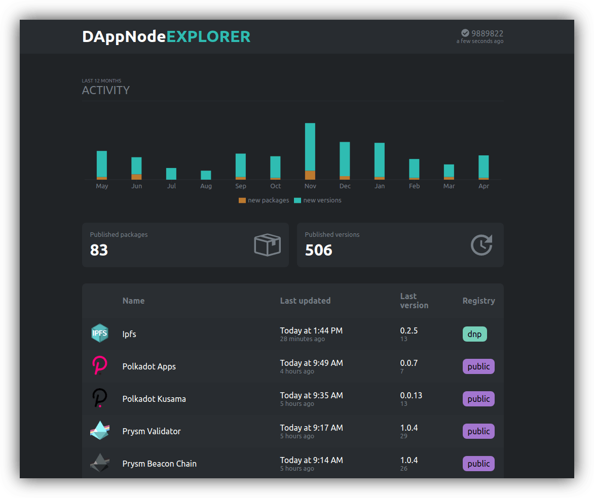

# DAppNode explorer

[explorer.dappnode.io](https://explorer.dappnode.io)

View DAppNode package activity and history

## Release dashboard

The existing Packages page remains the default. Open `/#/dashboard` for all-package release tracking, summary cards, and table/network-matrix views. The main controls are search, package-type buttons, and a recent-period selector (7/30 days, 3/6 months, or a year). Network, role, release status, PRs, archived state, custom dates, and sorting are in Advanced, collapsed by default. An active count indicates when hidden controls affect the results. All filters are preserved in the URL; existing custom-date links still work. Recent periods advance with time; calendar-month periods clamp to the target month's last day where needed. Custom dates use the browser's local timezone and include the whole through day. This is a current-state view, not a historical event log.

Set the GitHub Actions **repository variable** `REACT_APP_DASHBOARD_API_URL` to `https://tropibot.dappnode.net/v1/explorer/dashboard`. The deployment workflow passes it into the build. For local development, set the same variable in `.env.development.local` (see `.env.example`). Without a value, the app uses `/v1/explorer/dashboard` on its own origin for same-origin/proxy setups.

Pending releases are sized by their largest upstream version change (patch, minor or major); DAppNode's own helper repositories count only when a package pins nothing else, and a release whose upstreams are unknown or unchanged stays unsized. Each release's IPFS hash is checked from the browser against the dev gateway (`REACT_APP_IPFS_DEV_GATEWAY`, default `https://ipfs-gateway-dev.dappnode.net`); Refresh re-checks hashes that were missing.

Run `yarn start` and open `http://localhost:3000/#/dashboard`. The development server proxies dashboard requests to the configured endpoint, so Tropibot does not need to allow localhost through CORS. Production builds call the configured endpoint directly.

The URL is public configuration, so it belongs in Variables rather than Secrets; React embeds it in the browser bundle. Rebuild after changing it. Tropibot must allow the Explorer origin through CORS and expose `ETag`. No GitHub or GraphQL credentials are used by this page.

The dashboard consumes [schema 2 of the contract](doc/dashboard-contract.md); the [wire types](doc/dashboard-api-v2.ts) are mirrored verbatim in `src/dashboard/types.ts`. The snapshot is repository-first: each package row is one package as declared by one GitHub repository, so a package still named by an archived former repository appears once more, hidden with other archived rows by default. The page validates incoming snapshots, polls at the advertised interval, uses conditional requests, and retains cached data after refresh failures. A repository or source is shown as stale when it reports a problem, its last successful read exceeds the freshness limit, or the page's own refresh failed. Source errors, stale data, and unclassified packages remain visible. A missing service displays an unavailable state; no sample data is substituted.

Run `yarn test --run` and `yarn build` to verify the frontend. The toolchain (Vite, Vitest) needs Node.js 22.12 or newer.
